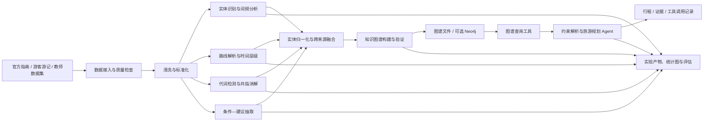

# 景区游览指南程序性知识挖掘系统架构说明

> 版本：1.0  
> 范围：覆盖《景区游览指南的程序性知识挖掘》探索性实验项目 1–7 及实验总结所需的系统设计。  
> 说明：本文是面向当前课程实验的推荐架构，不假定仓库中已经实现了文中所有模块或技术选型。工具可以替换，但输入、输出、证据链和验收目标应保持一致。

## 1. 建设目标与设计原则

系统从景区官方指南和游客游记中，构建可追溯的游览程序性知识，并通过知识图谱查询支持受约束的旅游规划。它不仅要产生最终结果，还应保留每一步的结构化中间产物，使实验结果能够复现、抽查、解释并写入报告。

核心目标：

1. 统一采集、清洗并检查多景区、多来源文本。
2. 识别景点 POI、交通方式、时间节点，并保留实体在文本中的位置。
3. 把多种路线写法转换为统一步骤和时间层级，保留原始顺序与不确定信息。
4. 对游记中的代词进行共指消解，记录人工标注和评估结果。
5. 抽取并分类“条件—建议”关系，保留证据及来源。
6. 融合多源知识、构建可查询和可视化的知识图谱。
7. 将图谱查询封装成 Agent 工具，生成受图谱证据约束的旅游规划。

设计原则：

- **证据优先**：所有抽取、对齐和规划结果都能回溯至文档及原文片段。
- **原文与推断分离**：原文事实、规则推断、模型预测、人工修订使用不同字段表示；不把缺失信息补写成事实。
- **阶段解耦**：各实验项目以版本化的结构化文件交接，不依赖一次性脚本中的隐式状态。
- **可替换技术**：分词、LLM、图存储、Agent 编排均经接口隔离，不绑定某个框架。
- **小规模可复现**：优先采用本地批处理和文件存储，避免课程实验不必要的分布式部署。
- **失败可观察**：记录处理状态、错误原因、模型/规则版本和评估证据，不以空结果掩盖失败。

## 2. 总体架构

建议采用**模块化单体 + 离线数据流水线 + 可选交互式 Agent**。对于课程规模数据，单个 Python 项目即可运行全部实验；不建议把每个实验拆成独立微服务。



### 2.1 分层职责

| 层 | 职责 | 主要输入 | 主要输出 |
|---|---|---|---|
| 入口层 | CLI 批处理；可选 Web/交互入口 | 命令参数、用户请求 | 任务状态、结构化结果 |
| 应用编排层 | 管理实验阶段顺序、批次、配置和运行记录 | 阶段配置、数据集版本 | 阶段产物及运行摘要 |
| 领域处理层 | 清洗、识别、路线解析、共指、条件抽取、融合、规划 | 标准化领域对象 | 实体、步骤、关系、计划 |
| 适配器层 | 封装文件、LLM、分词器、图存储和可视化等外部依赖 | 领域请求 | 统一接口返回值 |
| 存储与证据层 | 保存原文、阶段产物、人工标注、图谱和日志 | 版本化产物 | 可追溯、可复现的数据 |

领域逻辑不应直接依赖某个 LLM SDK 或图数据库 API。将模型调用定义为实体识别、共指、条件抽取、回答生成等接口的适配器；将图查询定义为图存储接口。没有配置模型密钥时，允许运行不依赖 LLM 的规则型实验阶段；若用户显式选择了 LLM 阶段但配置或调用失败，应报告错误并保留失败记录，不能静默退化成空结果。

## 3. 推荐项目目录

以下目录是建议的实现组织方式，可根据仓库现有代码调整；实验产物和大文件不应混入领域代码。

```text
.
├── src/
│   └── tourism_mining/
│       ├── cli.py                 # 命令行入口、参数校验
│       ├── config.py              # 路径、模型和运行配置
│       ├── application/           # 阶段编排及批处理用例
│       ├── domain/
│       │   ├── documents.py       # 文档、来源、文本区间
│       │   ├── entities.py        # 实体、实体提及、归一化
│       │   ├── routes.py          # 路线、步骤、时间层级
│       │   ├── coreference.py     # 代词、先行词、人工标注
│       │   ├── recommendations.py # 条件、建议及分类
│       │   └── graph.py           # 图谱节点、边和来源声明
│       ├── services/              # 清洗、识别、解析、融合、Agent
│       ├── ports/                 # LLM、图存储、数据仓储接口
│       └── adapters/              # JSON/CSV、NetworkX、Neo4j、模型实现
├── data/
│   ├── raw/                       # 原始输入，只读保留
│   ├── interim/                   # 阶段中间数据
│   └── processed/                 # 当前可供下游使用的数据
├── artifacts/
│   ├── reports/                   # 统计表、评估结果
│   ├── figures/                   # 词频图、路线图、图谱图
│   ├── graph/                     # 可加载图谱文件
│   └── runs/                      # 运行清单、错误和 Agent 轨迹
├── tests/
│   ├── unit/
│   ├── integration/
│   └── fixtures/
├── .env.example                   # 仅列变量名，不含真实密钥
└── ARCHITECTURE.md
```

`data/raw/` 中的数据应视为输入快照，不由清洗流程覆盖。对每次运行记录配置、输入文件校验值、代码版本（可获得时）、规则/模型版本和输出目录，以便区分不同实验结果。

## 4. 端到端处理流程

### 4.1 数据接入与预处理（项目 1）

1. 从教师数据集、手动整理文件或合规采集流程读入数据。
2. 为每条文档分配稳定的 `document_id`，记录景区、来源类型、出处和采集方式。
3. 清理 HTML、URL/无关元数据、异常空白与噪声字符；保留原文，不覆盖原始内容。
4. 对空值、重复记录和异常字段执行显式策略，输出检查统计和清洗前后样例。
5. 检查景区和文本类型覆盖。按任务书目标准备 3 个景区；采集设计以每景区约 1 条官方路线和 5 篇游客游记为目标，质量检查至少验证每景区有 1 条官方路线和 3 篇有效游记，并如实报告未达标项。

清洗过程要避免误删箭头、序号、时间表达或其他路线结构标记。可将“展示用清洗文本”和“解析用规范化文本”分开，明确后续字符位置所对应的文本版本。

### 4.2 实体识别与词频迭代（项目 2）

从清洗文本识别三类核心实体：景点 POI、交通方式、时间节点。词典/规则方案应输出命中依据；LLM 方案应记录模型标识、Prompt 版本、参数和原文证据。可先统计词频、人工检查噪声，再迭代停用词或词典，避免只展示词云而不说明优化依据。

### 4.3 路线结构挖掘（项目 3）

根据真实数据中出现的格式实现至少 1–2 种解析器，例如箭头链路、编号列表或按时间分段。解析后统一表示为有序步骤；缺失时间标为未知，不从常识补造。名称归一化应保留原名、规范名及对齐依据，谨慎区分子景点、父区域和周边景点。

项目需要时，将同一景区的官方路线和游客实际路线映射到相同表示，再计算至少两个可解释的对比指标，如景点覆盖、顺序一致性、时间分配或路线相似度。

### 4.4 共指消解（项目 4）

从选定游记检测代词，保留句子、出现位置及来源；为样本建立人工先行词标注，覆盖无明确先行词和不确定情形。候选生成可利用前文 POI/实体，规则、模型或 LLM 负责排序/判定。输出预测、置信度（若有）、判定状态和人工标注，按明确口径计算准确率/覆盖率，并保存消解前后的文本或知识表示。

### 4.5 条件—建议抽取（项目 5）

从官方指南和游记中发现条件触发表达，分别抽取条件部分、建议部分及条件类型。处理多建议、跨分句和条件不明确的句子；不满足抽取规则的结果可标记为待审或拒绝，并保留原因。近重复合并时保留全部来源，不因去重丢失证据。

### 4.6 多源融合与图谱（项目 6）

融合实体提及、路线步骤、共指结果和条件建议。对齐需同时考虑规范名、实体类型、景区范围和上下文；保留不合并的反例和人工修订记录。先导出可检查的图结构文件，再使用 NetworkX 构建和验证；若需要数据库交互，可增加 Neo4j 适配器，但不作为基础运行前提。

### 4.7 图谱支持的旅游规划 Agent（项目 7）

Agent 先提取景区、游客类型、出行时长及其他明确约束，再调用图谱工具获取候选景点、路线和条件建议。规划器基于工具实际返回的数据组织方案，回答中区分已知事实、规划选择和未知信息。无匹配、约束冲突、图查询失败或信息不足时，应说明问题并选择追问、返回部分结果或给出可解释的回退，不得将模型臆测包装成图谱事实。

## 5. 数据契约与核心对象

各阶段以 UTF-8 JSON/JSONL 作为推荐交换格式；CSV 适用于简单清单和统计。每个记录都应保留稳定 ID 与来源引用。字段可按实际实现扩展，但不可丢失下列核心语义。

### 5.1 文档与文本区间

```json
{
  "document_id": "doc-001",
  "park_id": "park-001",
  "park_name": "示例景区",
  "source_type": "official",
  "source_name": "景区官方指南",
  "source_url": null,
  "collected_at": null,
  "raw_text": "原始文本……",
  "clean_text": "清洗后的文本……",
  "cleaning_version": "clean-v1"
}
```

- `source_type` 使用稳定枚举，例如 `official`、`traveler`、`dataset`。
- URL、时间等来源字段未知时使用 `null`，不得虚构。
- 所有文本区间统一采用对应版本 `clean_text` 上的**Unicode 字符偏移**，起点从 0 开始、终点不包含；文档输出必须明确该约定。
- 任何会改变字符位置的清洗或归一化，应生成新版本并保留版本标识；不能用旧偏移标注新文本。

### 5.2 实体提及与归一化

实体“提及”表示一次文本出现；实体“规范对象”表示经谨慎归一化后的概念。二者分开存储，以便保留别名、重复出现和歧义。

```json
{
  "mention_id": "mention-001",
  "document_id": "doc-001",
  "text": "观景台",
  "entity_type": "poi",
  "start": 12,
  "end": 15,
  "text_version": "clean-v1",
  "canonical_entity_id": "poi-park-001-viewing-platform",
  "method": "dictionary",
  "evidence": "实体原文片段"
}
```

`entity_type` 至少覆盖 `poi`、`transport`、`time`。若无法可靠归一化，`canonical_entity_id` 可为空并记录待审状态。

### 5.3 路线与步骤

路线对象至少包含路线标识、景区、来源文档、路线类型和有序步骤。步骤至少包含序号、原文片段、景点、活动和时间信息；顺序以显式序号为准。时间信息分为原文明示、规则解析和未知，不将估计值混同于原文事实。

### 5.4 共指结果

共指记录至少包含 `document_id`、代词文本及区间、句子或上下文、预测先行词及区间、预测方法、状态、人工标注和是否纳入评估。每次代词出现使用独立 ID，避免同句相同代词互相覆盖。状态建议区分 `resolved`、`no_antecedent`、`uncertain`、`needs_review`。

### 5.5 条件—建议记录

建议至少保留 `recommendation_id`、来源景区/文档、原句和区间、条件类型、条件原文、条件描述、建议原文、去重簇 ID、抽取方法及人工审核状态。去重只合并语义记录，不删除来源或原文片段。

### 5.6 运行清单

每次阶段运行写入清单，至少记录 `run_id`、阶段名、开始/结束时间、输入清单或校验值、配置摘要、规则/模型版本、输出清单、成功/失败状态和错误摘要。不得在运行清单或报告中写入真实 API 密钥。

## 6. 知识图谱 Schema 建议

以下是能连接七个实验项目的最小 Schema，可按真实数据增删类型。关系方向应在代码和文档中保持一致。

### 6.1 节点类型

| 节点 | 用途 | 典型属性 |
|---|---|---|
| `Park` | 景区 | `park_id`、名称 |
| `Document` | 官方指南或游记 | `document_id`、来源类型、出处 |
| `POI` | 景点/游览地点 | `entity_id`、规范名、别名 |
| `Transport` | 交通方式 | `entity_id`、名称 |
| `TimeSlot` | 时间点或时段 | `time_id`、时段名称、原文状态 |
| `Route` | 官方路线或游客路线 | `route_id`、路线类型、来源 |
| `RouteStep` | 路线中的有序步骤 | `step_id`、序号、活动、原文片段 |
| `Condition` | 游客或环境条件 | `condition_id`、条件类型、描述 |
| `Recommendation` | 条件下的建议 | `recommendation_id`、内容 |
| `VisitorProfile` | 游客类型（如亲子、老人） | `profile_id`、名称 |

### 6.2 关系类型

| 关系 | 方向 | 语义及关键属性 |
|---|---|---|
| `HAS_DOCUMENT` | `Park → Document` | 景区相关来源文档 |
| `MENTIONS` | `Document → POI/Transport/TimeSlot` | 文档提及实体；可带区间和证据 |
| `HAS_ROUTE` | `Park → Route` | 景区关联路线 |
| `FROM_DOCUMENT` | `Route → Document` | 路线来源 |
| `HAS_STEP` | `Route → RouteStep` | 路线包含步骤；步骤带顺序号 |
| `NEXT` | `RouteStep → RouteStep` | 步骤先后关系 |
| `VISITS` | `RouteStep → POI` | 步骤访问景点 |
| `USES` | `RouteStep → Transport` | 步骤涉及交通方式 |
| `AT_TIME` | `RouteStep → TimeSlot` | 步骤对应的原文/推断时间 |
| `HAS_CONDITION` | `Recommendation → Condition` | 建议适用条件 |
| `SUGGESTS` | `Condition → Recommendation` | 条件触发的建议（若选定反向建模，应统一） |
| `FOR_PROFILE` | `Condition/Recommendation → VisitorProfile` | 游客类型约束 |
| `SUPPORTED_BY` | 事实节点/边 → `Document` | 支撑该事实的来源 |

避免同时用相反语义的重复边。若存储技术不支持边引用或边属性，可将来源证据建模为独立的 `Evidence` 节点，或把来源字段存入边属性。实体融合不等于证据融合：多篇来源可共同支持一个规范实体或关系，但应保留各自的文档、片段和方法信息。

## 7. 图谱查询与 Agent 契约

建议 Agent 由以下逻辑单元构成：

1. **约束解析**：得到景区、游客类型、时长、偏好和限制；未识别字段标为未知。
2. **查询决策**：根据缺失约束决定直接查询还是先追问。
3. **图谱工具**：执行类型明确、参数受限的查询。
4. **规划器**：依路线顺序、时间层级和条件建议组合候选方案，并检查冲突。
5. **回答生成**：引用实际检索到的景点/路线/建议，说明不确定项。
6. **轨迹记录**：保存解析结果、工具名与参数、工具返回、模型版本及最终输出。

图谱工具应返回结构化结果，而不是只返回一段自由文本。例如：

```json
{
  "status": "ok",
  "items": [
    {
      "poi_id": "poi-001",
      "name": "示例景点",
      "route_id": "route-001",
      "step_order": 1,
      "time_slot": "morning",
      "evidence": [
        {
          "document_id": "doc-001",
          "quote": "上午游览示例景点"
        }
      ]
    }
  ],
  "warnings": []
}
```

状态至少区分成功、有结果但部分字段未知、无匹配和执行错误。工具失败不应伪装成 `status: ok` 的空列表。Agent 的每个推荐项都应能链接到图谱结果或证据；没有证据时明确标注为未验证建议或不生成。

## 8. 运行方式与部署建议

### 8.1 批处理

将每个阶段做成可单独运行、可重复执行的 CLI 命令，并提供一个按依赖顺序运行全部阶段的入口。建议接口形态如下（具体命令名可按实现调整）：

```text
python -m tourism_mining.cli preprocess --input data/raw --output data/processed
python -m tourism_mining.cli extract-entities --input data/processed
python -m tourism_mining.cli parse-routes --input data/processed
python -m tourism_mining.cli resolve-coreference --input data/processed
python -m tourism_mining.cli extract-recommendations --input data/processed
python -m tourism_mining.cli build-graph --input data/interim
python -m tourism_mining.cli run-agent --graph artifacts/graph
```

命令应显式打印输入、输出、运行 ID 和完成状态；若失败，输出非零退出码及可定位错误。下游阶段应能从已保存的中间产物开始运行，避免每次都重新调用 LLM。

### 8.2 配置与外部依赖

- 通过配置文件或命令参数管理数据目录、抽取规则、模型名称和运行模式。
- API 密钥只从环境变量或本机密钥管理器读取；仓库仅提供 `.env.example` 变量名示例。
- LLM 请求配置超时和有限重试；达到重试上限后写明失败原因。对非确定性调用记录模型和必要参数。
- 默认图后端可采用 NetworkX + GraphML/JSON 文件；Neo4j、Web UI 或其他 LLM/Agent 框架属于可选适配器。
- 为离线规则阶段提供可复现路径，避免模型服务不可用时整个实验不可运行。

## 9. 验证、质量门槛与报告映射

### 9.1 自动化检查

- **数据**：必要字段、来源类别、景区覆盖、空值、重复、文本长度和编码。
- **实体**：类型枚举合法、区间满足 `0 <= start < end <= 文本长度`、片段与指定文本版本一致。
- **路线**：步骤序号唯一且有序；解析结果可回溯原文；未知时间不被写成明示时间。
- **共指**：每个出现位置有唯一记录；无先行词/不确定样本处理规则稳定；评测分母与纳入样本一致。
- **建议**：条件和建议边界可核验；去重前后数量可统计；合并记录保留来源。
- **图谱**：关系两端类型符合 Schema；路线步骤顺序连贯；关键节点/边均有来源证据。
- **Agent**：工具参数和返回符合 Schema；至少覆盖亲子/老人/情侣等不同场景，以及无结果、信息不足和冲突约束。

### 9.2 测试层次

1. **单元测试**：清洗边界、路线格式解析、偏移计算、实体归一化、条件切分等纯逻辑。
2. **集成测试**：固定小型 fixture 贯穿清洗—抽取—构图，验证文件契约和证据链。
3. **评估样例**：人工标注实体、共指和条件建议样本，输出实际计数及适用分母。
4. **Agent 场景测试**：固定图谱和输入请求，检查查询工具调用、约束满足和证据引用，而非只比对自然语言全文。

测试数据应包含成功样例和失败/边界样例。报告至少给出输入、预期检查点、实际结果和结论；抽样评估应如实说明样本规模及局限。

### 9.3 与实验报告章节的对应

| 实验/报告章节 | 架构模块 | 应提交或保存的主要证据 |
|---|---|---|
| 项目 1 / 第 1 章 | 数据接入、清洗、质量检查 | 来源说明、结构化数据、前后对比、质量统计 |
| 项目 2 / 第 2 章 | 实体识别、词频统计 | 实体规范表、带位置 JSON、词频图、迭代记录 |
| 项目 3 / 第 3 章 | 路线解析、归一化、层级构建 | 解析样例、路线 JSON、层级结果、可选路线对比 |
| 项目 4 / 第 4 章 | 共指识别与评估 | 待消解样本、人工标注、预测、指标和错误案例 |
| 项目 5 / 第 5 章 | 条件建议抽取与去重 | 映射表、类别统计、去重记录、人工审核样例 |
| 项目 6 / 第 6 章 | 融合、Schema、图谱与可视化 | 节点/边统计、可加载图谱、可视化、查询验证 |
| 项目 7 / 第 7 章 | 图谱工具与 Agent | 工具 Schema、完整调用轨迹、多场景测试、配置说明 |
| 实验总结 / 第 8 章 | 运行记录、评估和错误分析 | 至少两个真实失败现象、分层归因、局限及一个突破点方案 |

报告中的图表和示例应标明图题/表题、输入数据范围和对应产物位置。运行截图只能作为补充，不能替代源代码、结构化输出、评估数据或日志。

## 10. 实施优先级

1. 先定文档、景区、来源类型、文本偏移和产物版本等基础契约。
2. 完成项目 1 的可复现数据集和质量检查；锁定清洗文本版本。
3. 并行完成实体、路线、共指和条件抽取模块，各自输出可校验文件。
4. 用来源证据和归一化策略融合结果，构建图谱并验证典型路径。
5. 最后接入 Agent 工具，基于固定图谱测试约束解析、回退和证据引用。
6. 全程保存人工修订、失败样例和运行配置，为报告分析提供真实材料。

采用这一顺序可让每个实验项目都有独立、可检查的结果，同时保证最终 Agent 使用的是可追溯的知识图谱，而不是与前序实验脱节的演示原型。
